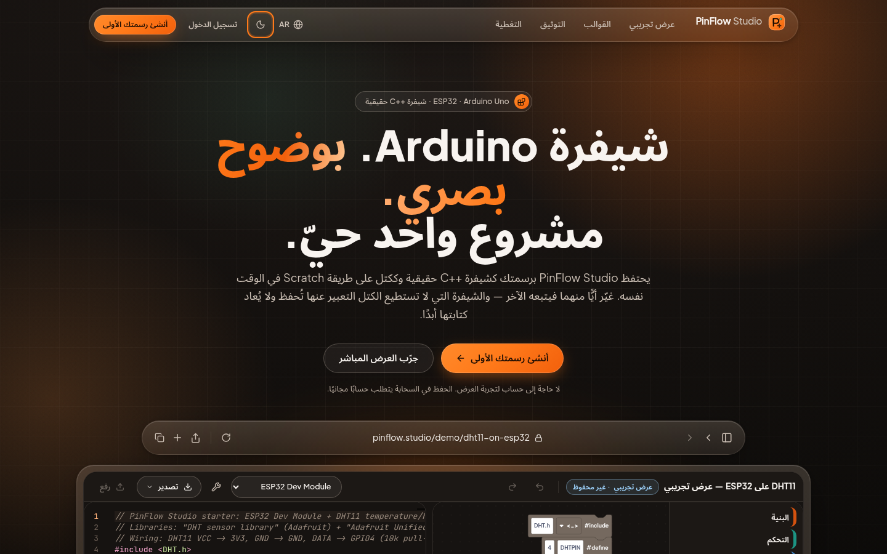
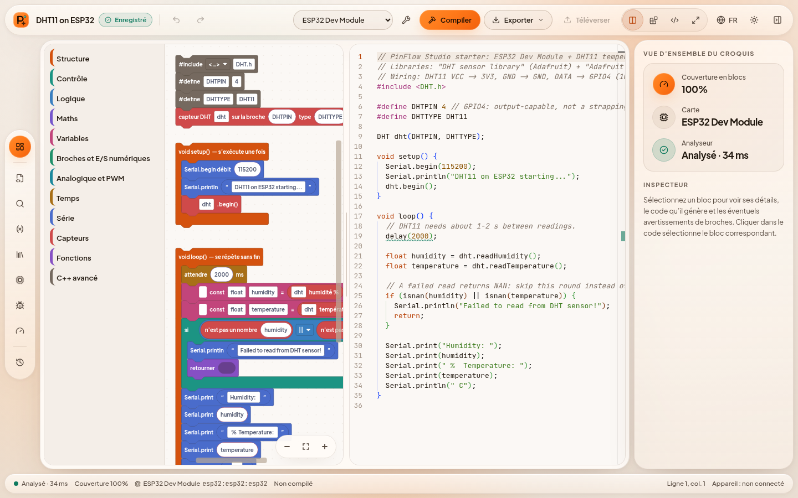
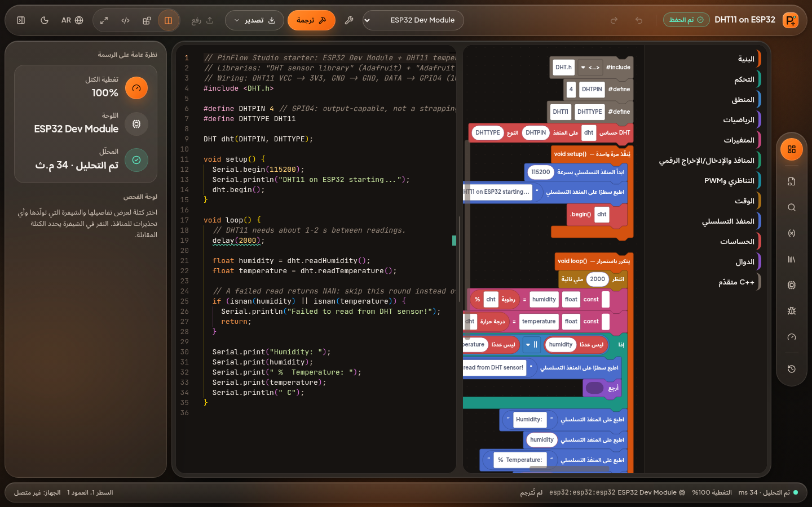
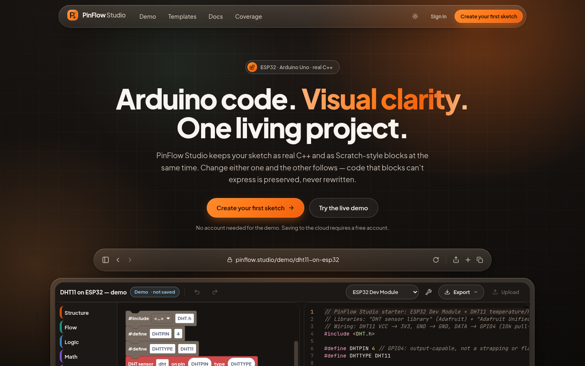
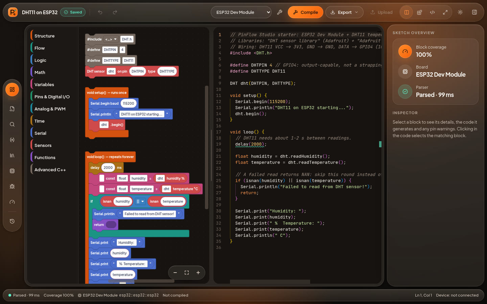
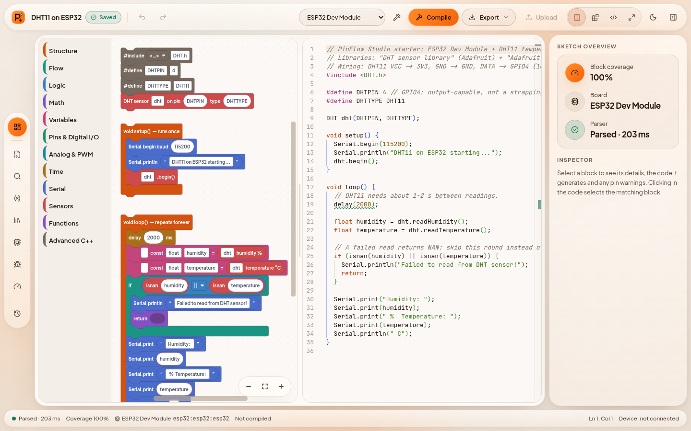
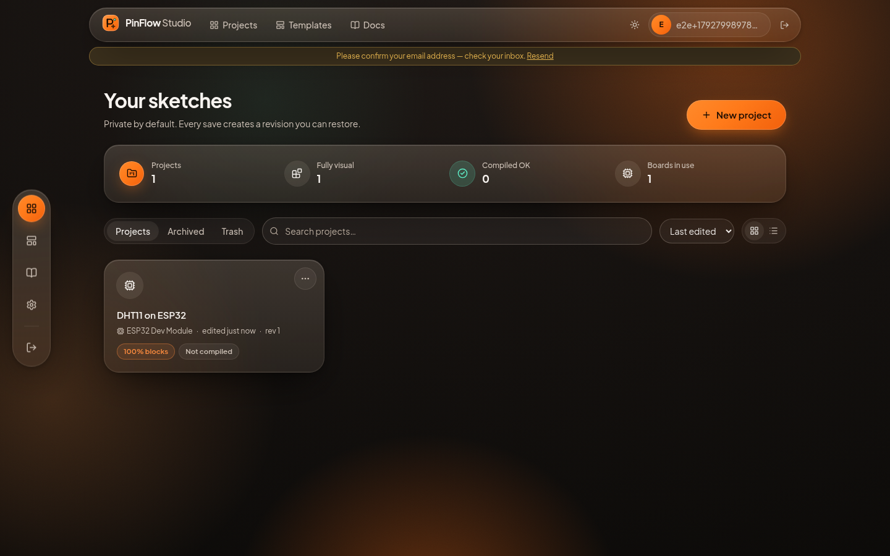
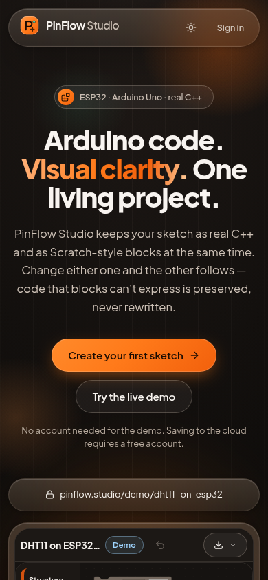
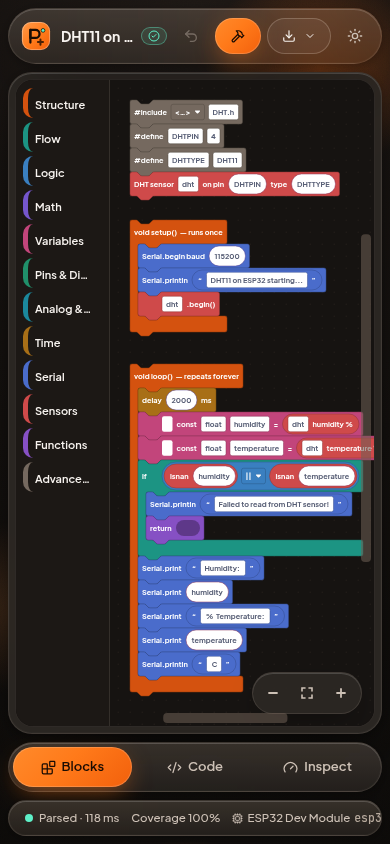
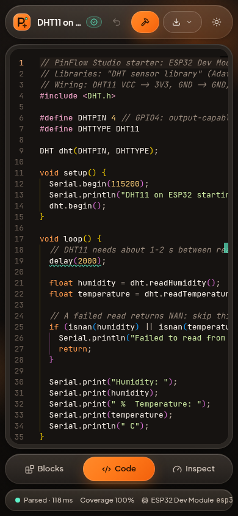

# PinFlow Studio

Arduino code. Visual clarity. One living project.

A web Arduino / ESP32 editor where real C++ (Monaco) and Scratch-style blocks (Blockly) stay synchronized both ways over a documented C++ subset. Code that blocks cannot represent is preserved byte-for-byte in "Advanced C++" blocks, never rewritten. Compilation uses the real Arduino CLI.

Live status of every feature: [docs/implementation-status.md](docs/implementation-status.md). Original spec: [docs/master-spec.md](docs/master-spec.md).

## Layout
- `packages/arduino-ir` IR contract · `cpp-parser` tree-sitter C++ -> IR (+ Web Worker) · `arduino-codegen` IR -> C++ + source maps · `sync-engine` revisions/origins/undo · `board-registry` boards, pin rules, library packs · `block-definitions` Blockly blocks + adapter · `database` Drizzle + PGlite/Postgres
- `apps/web` Next.js 16 app (landing, auth, dashboard, workbench) · `apps/compile-worker` arduino-cli job service · `apps/local-bridge` optional loopback upload bridge (not hardware-tested)
- `examples/`, `fixtures/` (parser golden, compile), `docs/`, `infra/`

## Prerequisites
Node 22, pnpm 10. For compiling: run `infra/scripts/setup-arduino-toolchain.sh` (installs arduino-cli 1.5.1, arduino:avr 1.8.8, esp32:esp32 3.3.12, DHT sensor library 1.4.7, Adafruit Unified Sensor 1.1.15 into `.arduino-cache`).

## Run
```bash
pnpm install
# compile worker (terminal 1)
cd apps/compile-worker && COMPILE_WORKER_TOKEN=$(openssl rand -hex 24) PORT=4100 pnpm start
# web app (terminal 2)
cd apps/web && cp .env.example .env.local   # set COMPILE_WORKER_URL + COMPILE_WORKER_TOKEN
pnpm build && pnpm start                     # http://localhost:3000
```
The database defaults to embedded PGlite (migrations run on first request). Set `DATABASE_URL` for PostgreSQL.

## Test
```bash
pnpm -r --if-present test                   # unit / round-trip / property tests in every package
pnpm -r --if-present typecheck
cd apps/web && pnpm build && pnpm test:e2e  # Playwright against `next start` (PW_CHROMIUM_PATH on arm64)
# real compile from the UI (blink-uno on arduino:avr:uno), with the worker running on :4100
E2E_COMPILE=1 COMPILE_WORKER_URL=http://127.0.0.1:4100 COMPILE_WORKER_TOKEN=… pnpm exec playwright test compile-real.spec.ts
E2E_SCREENSHOTS=1 pnpm exec playwright test screenshots.spec.ts   # regenerates docs/screenshots
DATABASE_URL=postgres://… pnpm --filter @pinflow/database test   # repositories against a real PostgreSQL
PINFLOW_INTEGRATION_ESP32=1 pnpm --filter @pinflow/compile-worker test:integration
```
E2E specs: `workbench.spec.ts` (DHT11 sync / raw preservation / syntax banner / save-reload / export, access control, no-worker honesty), `flows.spec.ts` (onboarding, every template, rename / duplicate / trash / restore / delete, history restore, ZIP export, `.ino` import, theme, layout modes, rail, zoom, phone tabs, zero console errors), `i18n.spec.ts` (French/Arabic switch on the landing page and in the workbench, `dir=rtl`, Accept-Language first visit, live block re-render with identical code, light/dark/system theme persistence; `E2E_SCREENSHOTS=1` also writes `docs/screenshots/i18n-*.png`), `compile-real.spec.ts` (opt-in), `screenshots.spec.ts` (opt-in).

## Using it
1. Sign up, pick a board and a template (ESP32 + DHT11 is the guided one) or import an `.ino`/`.zip`.
2. Blocks on the left, C++ on the right. Edit either; the other follows. The status bar shows parse state and block coverage.
3. A syntax error keeps the last valid blocks with a banner until the code parses again.
4. Compile sends the exact saved revision to the worker; diagnostics jump to the line and its block. Results go "outdated" when the code changes.
5. Export `.ino` or a ZIP any time. History lets you diff, restore or duplicate a revision.

## Languages (English · Français · العربية)
The whole product is available in **English** (default and fallback), **French** and **Arabic** (right-to-left), mBlock-style: the globe button in every header (public site, auth pages, onboarding, dashboard/app header and the workbench top bar) switches the interface, every block's text, dropdown captions, tooltips, block context menus, the toolbox categories and block search — live, without losing the workspace. Next to it, a sun/moon menu chooses **light**, **dark** or **system** theme (Blockly and Monaco follow live).

- **How the language is chosen:** `pf-locale` cookie (set by the switcher, also kept in `localStorage`) → `Accept-Language` on the first visit → English. The root layout renders `<html lang dir>` on the server, so there is no flash of the wrong language; Arabic sets `dir="rtl"` and uses the self-hosted Noto Sans Arabic font (OFL).
- **UI text:** `apps/web/src/i18n/messages/{en,fr,ar}.ts` — flat, type-safe keys (`MessageKey` is derived from `en.ts`; a typo is a compile error). `useT()` in client components, `await getT()` in server components and server actions; missing keys fall back to English. Server validation messages are message keys translated per request.
- **Block text:** `packages/block-definitions/src/i18n/{en,fr,ar}.ts` (`bm()`, `setBlockLocale()`, `localizeEntry()`, `searchToolbox(q, n, locale)` which matches the active language **and** English, accent-insensitive). Only display text is translated: block types, field names, field values, IDs, the IR and the generated C++ never depend on the language. Switching re-creates the Blockly workspace from its serialized state (Arabic in a Blockly `rtl: true` workspace) and loads Blockly's own core messages (`blockly/msg/fr`, `blockly/msg/ar`) for its context menus.
- **Docs:** the getting-started page is translated; the generated parser coverage reference and the legal pages (terms, privacy) stay English with a short note.
- **Tests:** dictionary + block-text completeness and placeholder checks, Accept-Language negotiation, and "every template generates byte-identical C++ after en → fr → ar → en" (`apps/web/test/i18n.test.ts`, `packages/block-definitions/test/i18n.test.ts`), plus `tests/e2e/i18n.spec.ts`.

| | |
|---|---|
|  |  |
| Landing — Arabic, right-to-left | Workbench — French, light theme |
|  | |
| Workbench — Arabic, dark theme, RTL Blockly canvas | |

## Screenshots
Warm liquid-glass UI (design tokens and rules: [docs/design-system.md](docs/design-system.md)). Captured from `next start` by `tests/e2e/screenshots.spec.ts`.

| | |
|---|---|
|  |  |
| Landing — the real workbench in a floating glass window | Workbench — floating pill rail, glass inspector, Blockly + Monaco in sync |
|  |  |
| Workbench — warm frosted light theme | Dashboard — stats strip and glass project tiles |

<p>
  
  
  
</p>

## Deploying (Vercel readiness — not deployed)
The web app deploys as a Next.js project with **Root Directory `apps/web`**; `apps/web/vercel.json` installs from the monorepo root (`pnpm install --frozen-lockfile`) and runs `pnpm build` (which runs `prepare-assets`). Two things must live outside Vercel:

- **Database — `DATABASE_URL` is required.** Embedded PGlite writes to the local filesystem, which does not persist on serverless functions. Use a hosted PostgreSQL (e.g. Neon, Supabase, RDS) and set `DATABASE_URL=postgres://…`; migrations run automatically on first request through the bundled `pg` (node-postgres) driver. The server refuses to start on Vercel without it (`assertPersistentDatabase` in `apps/web/src/server/db.ts`). The Postgres path is exercised by the database test suite and an e2e run against PostgreSQL 17 (see docs/implementation-status.md).
- **Compile worker — host it elsewhere.** `apps/compile-worker` needs `arduino-cli`, the AVR/ESP32 cores and long-running processes (a VM or container, see `infra/docker`). Point the app at it with `COMPILE_WORKER_URL` and a 24+ character `COMPILE_WORKER_TOKEN` (server-side env vars only). Without them, Compile reports "Compile unavailable".
- Also set `APP_URL` (https origin, enables Secure cookies). Mail has no SMTP transport yet (dev outbox only).

See `docs/` for architecture, parser coverage, synchronization, security threat model, compile worker, boards and bridge.
